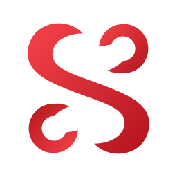
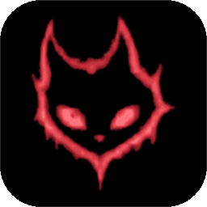
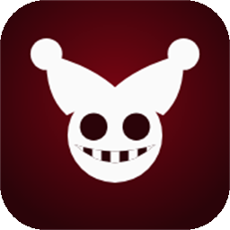
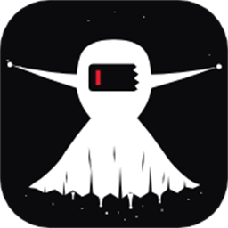
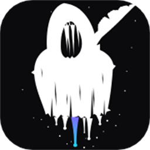

<div align="center">

<a href="https://snns.dev"></a>

<p>
<a href="https://snns.dev"></a>

<a href="./LICENSE"></a>
<a href="./SUPPORT.md"></a>
</p>

<p><a href="https://snns.dev"><b>Website</b></a> &nbsp;·&nbsp; <a href="./ACCESS.md"><b>Get in</b></a> &nbsp;·&nbsp; <a href="./TUTORIALS.md"><b>First hour</b></a> &nbsp;·&nbsp; <a href="./API.md"><b>API</b></a> &nbsp;·&nbsp; <a href="./PRICING.md"><b>Pricing</b></a> &nbsp;·&nbsp; <a href="./SUPPORT.md"><b>Support</b></a></p>

</div>

<br>

<!-- v2:a -->
<table>
<tr>
<td width="150" align="center"></td>
<td>
<b>S&amp;NS for Windows</b>: a small window onto snns.dev with its own icon, its own start screen, and a frame that takes the app's colour.<br><br><a href="https://github.com/loverhaterlmao/snns-suite/releases/latest"></a>
<br><br><b>On a phone:</b> open <a href="https://snns.dev">snns.dev</a> in your browser and choose <i>Add to Home Screen</i> (iPhone: the Share button; Android: the menu, then <i>Install app</i>).
</td>
</tr>
</table>
<!-- /v2:a -->


Sick & Nexra Studios (S&NS) makes a small family of tools. This page says what each one is, where to open it, and how
to get in. The source code of every project is closed; these repositories hold the guides, the terms and the place to
report problems.

| Project | What it is | Where |
|---|---|---|
| **Noetic Suite** | One AI assistant with a whole studio behind it. Ask in a sentence and get it finished: a game, a site, a document, a picture. Planned, built, run, reviewed and fixed before it reaches you. | [noetic.lol](https://noetic.lol) |
| **Claw** | Private code workspaces your AI can write to, with cloud sandboxes, real terminals, a built-in copilot and a command-line tool. Save a zip or commit to GitHub. | [sick.cat](https://sick.cat) |
| **Sykbot** | Discord server management: moderation, verification, anti-raid, tickets and logging, all set up inside Discord. | [sykbot.com](https://sykbot.com) · docs at [sickenn.info](https://sickenn.info) · account at [sicken.me](https://sicken.me) |
| **Beat.rip** | A username checker for 57 platforms and every popular domain, asked of each platform itself, with an honest "unknown" when one will not say. | [beat.rip](https://beat.rip) |
| **Ink** | A document editor that measures how text was written and says exactly what it measured. | [wrote.ink](https://wrote.ink) |

The studio's own page is [snns.dev](https://snns.dev).

<!-- v2:b -->
## What we are for

**Knowledge should be free.** Not the slogan: the practice. Everything we learn building these tools that would
help someone else build theirs gets written down in the open, in plain words: how to use them, how they are kept
safe, what they measure and what they do not. We keep a free way into our tools wherever we can. Nobody should be
kept from learning to make things by what is in their pocket.

**Strive for your best.** We build for the person in the middle of making something, trying to make it good. So
the tools do the work properly instead of looking like they did: they run what they build, check it, and say
plainly when something is unknown or did not work.

**Chase better, and never settle for less.** None of this is finished and we do not pretend it is. When something
here is not good enough we rebuild it until it is. That is the standard we hold ourselves to, and the one we hope
the tools help you hold yourself to.

A fair question: if knowledge should be free, why is the source closed? Because the *knowledge* is in what the
tools teach and what we publish about how they work, and that is open. The code is how a small studio keeps the
lights on. We would rather say that plainly than pretend otherwise.

## The projects

<table>
<tr>
<td width="110" align="center"><a href="https://github.com/loverhaterlmao/noetic-suite"></a></td>
<td><b><a href="https://github.com/loverhaterlmao/noetic-suite">Noetic Suite</a></b> &nbsp;·&nbsp; <a href="https://noetic.lol">noetic.lol</a><br>One AI assistant with a whole studio behind it. Ask in a sentence and get it finished: a game, a site, a document, a picture.<br><a href="https://github.com/loverhaterlmao/noetic-suite">Repository</a> · <a href="https://github.com/loverhaterlmao/noetic-suite/releases/latest">Release notes</a></td>
</tr>
<tr>
<td width="110" align="center"><a href="https://github.com/loverhaterlmao/claw"></a></td>
<td><b><a href="https://github.com/loverhaterlmao/claw">Claw</a></b> &nbsp;·&nbsp; <a href="https://sick.cat">sick.cat</a><br>Private code workspaces your AI can write to, with cloud sandboxes, real terminals, a built-in copilot and a command-line tool.<br><a href="https://github.com/loverhaterlmao/claw">Repository</a> · <a href="https://github.com/loverhaterlmao/claw/releases/latest">Windows app</a></td>
</tr>
<tr>
<td width="110" align="center"><a href="https://github.com/loverhaterlmao/sykbot"></a></td>
<td><b><a href="https://github.com/loverhaterlmao/sykbot">Sykbot</a></b> &nbsp;·&nbsp; <a href="https://sykbot.com">sykbot.com</a><br>Discord server management: moderation, verification, anti-raid, tickets and logging, all set up inside Discord.<br><a href="https://github.com/loverhaterlmao/sykbot">Repository</a> · <a href="https://github.com/loverhaterlmao/sykbot/releases/latest">Windows app</a></td>
</tr>
<tr>
<td width="110" align="center"><a href="https://github.com/loverhaterlmao/beat-rip"></a></td>
<td><b><a href="https://github.com/loverhaterlmao/beat-rip">Beat.rip</a></b> &nbsp;·&nbsp; <a href="https://beat.rip">beat.rip</a><br>A username checker for 57 platforms and every popular domain, asked of each platform itself.<br><a href="https://github.com/loverhaterlmao/beat-rip">Repository</a> · <a href="https://github.com/loverhaterlmao/beat-rip/releases/latest">Windows app</a></td>
</tr>
<tr>
<td width="110" align="center"><a href="https://github.com/loverhaterlmao/ink"></a></td>
<td><b><a href="https://github.com/loverhaterlmao/ink">Ink</a></b> &nbsp;·&nbsp; <a href="https://wrote.ink">wrote.ink</a><br>A document editor that measures how text was written and says exactly what it measured.<br><a href="https://github.com/loverhaterlmao/ink">Repository</a> · <a href="https://github.com/loverhaterlmao/ink/releases/latest">Windows app</a></td>
</tr>
</table>

Each has its own repository with its own page, licence, terms and releases. This one is the map.

## How it started

The studio's first tool was Claw, and Claw began as a fix for one annoyance: getting code *out* of AI chat.
Providers such as Venice would write a whole project and leave you to copy it out by hand, with no download and no
connector to an editor. Claw gave the AI somewhere to write the files directly, so what it wrote ended up in your
hands as working files. [The longer version](https://github.com/loverhaterlmao/claw#where-claw-came-from). The same stubbornness runs through
the rest: a name checker that asks each platform itself instead of guessing, an editor that says exactly what it
measured, an assistant that runs what it builds before it hands it over.



Every project has a small Windows app: the same site in its own window, with its own icon and start screen.
Get each from its repository's releases. The S&NS one is [here](https://github.com/loverhaterlmao/snns-suite/releases/latest).

## The small print

[Terms of use](TERMS.md) · [Privacy](PRIVACY.md) · [Acceptable use](ACCEPTABLE_USE.md) · [Licence](LICENSE) · [Everything legal, in one page](LEGAL.md)
<!-- /v2:b -->

## Open to everyone

Noetic Suite is open: anyone can create a free account. The free plan has a daily limit of requests, and paid plans
lift it. What we still do not want is bulk sign-ups, resellers, or accounts made to probe the service.

[snns.dev](https://snns.dev), [noetic.lol](https://noetic.lol), [beat.rip](https://beat.rip) and [wrote.ink](https://wrote.ink) are written in 18
languages (English, Spanish, Portuguese, French, German, Italian, Dutch, Polish, Turkish, Russian, Ukrainian, Arabic, Hindi, Indonesian, Vietnamese, Japanese, Korean and Chinese); your browser's own language is chosen for you.

## Getting in, step by step

1. **Create a free account** at [noetic.lol](https://noetic.lol): an email address and a password, or a GitHub account.
2. **Secure it** (user menu → *Sign-in and security*): add an authenticator app or a passkey.
3. **Start.** [TUTORIALS.md](TUTORIALS.md) walks through the first hour.

## The desktop app (Windows)

People with an account can download Noetic Suite for Windows. The download is behind your sign-in on purpose:

- sign in at [noetic.lol](https://noetic.lol), then open **user menu → Get the desktop app**, or go to
  `https://noetic.lol/download`;
- check the file against the SHA-256 shown on that page before you run it;
- unzip it anywhere and open `NoeticSuite.exe`. Windows will warn that the publisher is unknown, because the build is
  not code-signed yet.

Please do not pass the file on. People who want it can apply.

## In this repository

| File | What is in it |
|---|---|
| [ACCESS.md](ACCESS.md) | Who gets in, how applications are judged, what an account can and cannot do |
| [TUTORIALS.md](TUTORIALS.md) | First steps in Noetic: chat, building, pictures, projects, security, support |
| [API.md](API.md) | Calling Noetic from your own programs: keys, examples, errors, limits |
| [PRICING.md](PRICING.md) | Plans, seats, pay-as-you-go credit and what paying changes |
| [FAQ.md](FAQ.md) | The questions people ask first |
| [ROADMAP.md](ROADMAP.md) | What is being worked on |
| [CHANGELOG.md](CHANGELOG.md) | What changed, and when |
| [SECURITY.md](SECURITY.md) | How to report a weakness, what is in scope, what we will not chase you for |
| [SUPPORT.md](SUPPORT.md) | How to reach a person |
| [LEGAL.md](LEGAL.md) | Terms of use, acceptable use, privacy, testing terms, intellectual property |

## Support

Write to **support@snns.dev**, use the form at [noetic.lol/support](https://noetic.lol/support), or, inside Noetic,
**user menu → Contact support**. Problems with these guides can be opened as issues here. Do not put passwords,
keys or personal details in an issue.

## The API in one breath

```bash
curl https://noetic.lol/v1/chat/completions \
  -H "Authorization: Bearer $NOETIC_KEY" -H "Content-Type: application/json" \
  -d '{"model":"noetic-0.1","messages":[{"role":"user","content":"Hello"}]}'
```

Keys are made inside Noetic. Everything else is in [API.md](API.md).

<br>

<div align="center">

<sub>Part of the S&NS family</sub><br>
<a href="https://github.com/loverhaterlmao/noetic-suite"><b>Noetic Suite</b></a> &nbsp;·&nbsp; <a href="https://github.com/loverhaterlmao/claw"><b>Claw</b></a> &nbsp;·&nbsp; <a href="https://github.com/loverhaterlmao/sykbot"><b>Sykbot</b></a> &nbsp;·&nbsp; <a href="https://github.com/loverhaterlmao/beat-rip"><b>Beat.rip</b></a> &nbsp;·&nbsp; <a href="https://github.com/loverhaterlmao/ink"><b>Ink</b></a><br><br>
<a href="https://snns.dev"><b>snns.dev</b></a> &nbsp;·&nbsp; <a href="https://github.com/loverhaterlmao/snns-suite">S&NS Suite</a> &nbsp;·&nbsp; <a href="mailto:support@snns.dev">support@snns.dev</a>

<sub>© Sick & Nexra Studios. All rights reserved. No licence to the software is granted by this repository.</sub>

</div>
